  <!-- 1. HERO MATRIX RAIN & IDENTITY -->
  

  

    <strong>Developer</strong> &bull; Based in <strong>Vietnam</strong>
  

  <!-- 2. MATRIX COMMAND PROMPT TYPING -->
  

  <!-- 3. COMPACT BADGES -->
  

    
    &nbsp;
    
  

## WHO AM I ?

> *"Code is poetry written for computers and humans to read."*

Hi, I'm **Do Hai Dang** &mdash; a software developer based in **Vietnam**, working across web and backend development with **Java, Python and JavaScript**.

* **Engineering Mindset:** I build reliable, maintainable and scalable software, with close attention to code quality and user experience.
* **Continuous Learning:** I keep growing my skills across languages, frameworks and system design, and apply new ideas to real problems.
* **Collaboration:** I value clear communication and teamwork, and I'm open to collaborations and contributions.

## CURRENT FOCUS

> I'm focused on turning ideas into reliable, well-crafted software &mdash; from clean interfaces to backend services that scale.
> Right now I'm sharpening my system design skills and learning something new every day.

## LOADED MODULES

  

## CONTRIBUTIONS

  <picture>
    <source media="(prefers-color-scheme: dark)" srcset="./dist/github-snake-dark.svg" />
    
  </picture>

## CONNECT

> Open to collaborations &mdash; feel free to reach out via email or LinkedIn. Let's build something together.

<table width="100%">
  <tr>
    <td width="18%" valign="middle"><strong>EMAIL</strong></td>
    <td width="82%" valign="middle"><a href="mailto:dangdohai.work@gmail.com">dangdohai.work@gmail.com</a></td>
  </tr>
  <tr>
    <td width="18%" valign="middle"><strong>WEBSITE</strong></td>
    <td width="82%" valign="middle"><a href="https://dohaidang.site/">https://dohaidang.site/</a></td>
  </tr>
  <tr>
    <td width="18%" valign="middle"><strong>LINKEDIN</strong></td>
    <td width="82%" valign="middle"><a href="https://www.linkedin.com/in/dohaidang202/">dohaidang202</a></td>
  </tr>
  <tr>
    <td width="18%" valign="middle"><strong>FACEBOOK</strong></td>
    <td width="82%" valign="middle"><a href="https://www.facebook.com/dohaidang32241/">dohaidang32241</a></td>
  </tr>
</table>

  
    If you find my projects interesting or useful, please consider giving them a &#11088; star &mdash; your support means a lot!
  
    
  
    Engineered by <a href="https://github.com/dohaidang"><strong>Do Hai Dang</strong></a>
    &mdash; Developer &mdash; Vietnam
  

